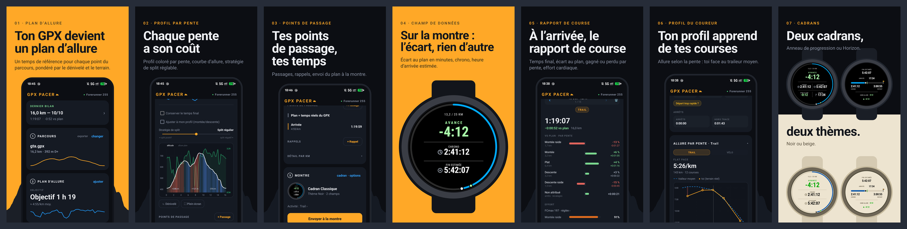
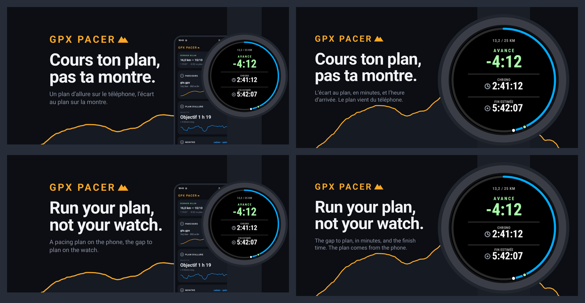
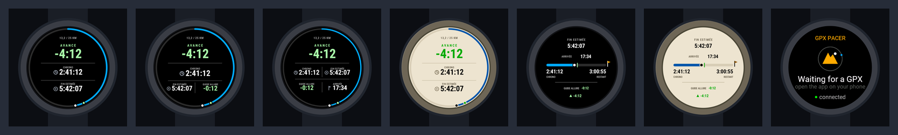

# Visuels des stores — GPX Pacer

Images de présentation pour la fiche **Google Play** (application Android) et la fiche
**Connect IQ** (champ de données montre), composées à partir des captures réelles du
kit (`src/assets/`). Tout est généré par `src/build.mjs` ; rien n'est retouché à la main.

## Aperçu





## Livrables

| Dossier | Contenu | Format |
|---|---|---|
| `play/fr/`, `play/en/` | 7 captures d'écran téléphone (ordre et légendes du brief) | 1080 × 1920, PNG RGB |
| `play/feature_play_1024x500_{fr,en}.png` | Image de présentation Play | 1024 × 500, PNG 24 bits sans alpha, textes dans la zone sûre (15 %) |
| `connectiq/hero_connectiq_1440x720_{fr,en}.png` | Bandeau de la fiche Connect IQ | 1440 × 720, PNG RGB |
| `connectiq/montre/` | 7 écrans montre : anneau (2/3/4 champs, noir ; 2 champs, beige), Horizon (noir, beige), écran d'attente | 800 × 800, PNG RGB, fond uni `#0C0E13` |
| `apercu/` | Planches de vignettes (relecture) | — |

Les captures montre sont communes aux deux langues : les cadrans viennent de l'aperçu
téléphone (libellés français), l'écran d'attente du champ de données est en anglais.
Sur les visuels EN, les écrans d'application restent donc en français.

## Principes de composition

- Palette et typographie de l'application (Roboto, titres gras, capitales espacées),
  aplats uniquement : pas de dégradé, pas d'ombre, pas de lumière.
- Rythme de la série Play : ambre (01, 04), sombre (02, 03, 05, 06), noir / beige (07).
- La crête en arrière-plan est le **profil réel de `gta.gpx`** (16,2 km, 392 m D+),
  extrait de la capture plein écran (`src/assets/profil_gta.json`).
- Téléphone et montre sont des silhouettes génériques (aucune marque, aucun boîtier
  Garmin : l'écran d'attente est découpé au cercle de l'écran, sans le boîtier du
  simulateur).
- Le mot-symbole « GPX PACER ▲ » des bandeaux est recomposé en Roboto Bold espacé avec
  le pictogramme relevé sur l'en-tête de l'application.
- Les chiffres sont ceux des captures (course du 10/10/2026 ; démo du cadran : avance
  4:12, fin estimée 5:42:07).

## Série « Google » (`google/`)

Seconde série, dans l'esprit des fiches des applications Google : page ambre pâle, titre
Archivo, sous-titre Roboto, la capture dans un cadre de téléphone fin qui sort par le bas,
et selon l'écran une carte de l'interface agrandie (profil par pente, barres du bilan, courbe
allure / pente) ou la montre qui chevauche le téléphone. La crête du vrai profil de `gta.gpx`
reste en fond. Générée par `src/build_google.mjs` (mêmes captures, mêmes contraintes) :

| Dossier | Contenu | Format |
|---|---|---|
| `google/play/fr/`, `google/play/en/` | 7 captures téléphone | 1080 × 1920, PNG RGB |
| `google/play/feature_1024x500_{fr,en}.png` | Image de présentation Play | 1024 × 500 |
| `google/connectiq/hero_1440x720_{fr,en}.png` | Bandeau Connect IQ | 1440 × 720 |
| `google/apercu_{fr,en}.png` | Planches de relecture | — |

Polices : voir `src/assets/fonts/FONTS.md` (Archivo et IBM Plex Mono s'ajoutent à Roboto).

```sh
node store/src/build_google.mjs        # tout
node store/src/build_google.mjs fr     # filtre sur le nom de sortie
```

## Regénérer

```sh
node store/src/build.mjs          # tout
node store/src/build.mjs play/fr  # un sous-ensemble (filtre sur le nom de sortie)
python3 -I store/src/apercu.py    # planches d'aperçu
```

Prérequis : Node ≥ 20 avec `playwright` (et son Chromium), Python 3 avec Pillow.
`build.mjs` rend chaque visuel en HTML/CSS dans Chromium à la taille exacte, puis
`postprocess.py` aplatit les PNG en RGB et vérifie dimensions et poids (< 8 Mo).

Police : Roboto (variable), licence SIL OFL 1.1 (`src/assets/fonts/OFL.txt`).
